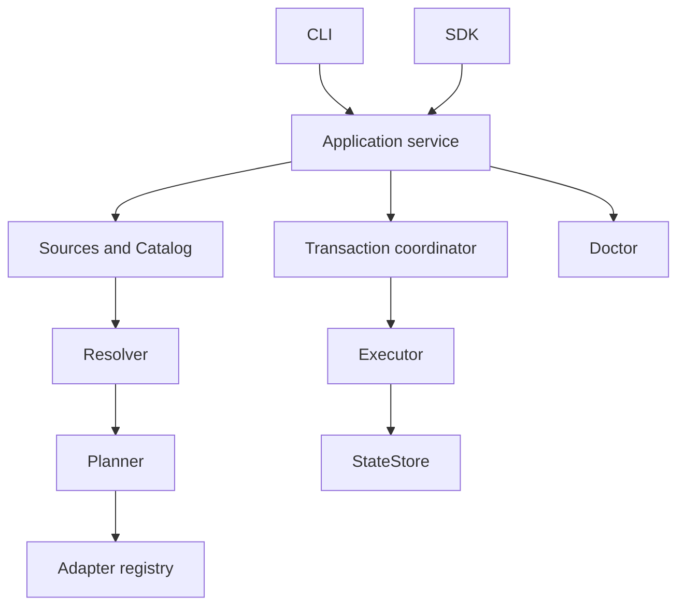

# Architecture

[简体中文](architecture.zh-CN.md)

This describes the implementation after architecture batches A and B (based on 1.0.0). The package exports `harnessbrew` and the adapter type contract `harnessbrew/adapter`. CLI and SDK share the application service; the legacy `src/core` backend has been removed.

## Responsibilities

| Layer | Responsibility | Boundary |
| --- | --- | --- |
| `domain` | Identities, versioned formats, ownership, graph and plan contracts | No orchestration or target writes |
| `sources` / `catalog` | Verify Git snapshots and content inventories; parse available assets | Updating a source does not upgrade installed assets |
| `resolution` | Resolve dependency closure and conflicts for all root requirements | Produces decisions without filesystem mutations |
| `planning` | Compare desired and committed state; produce operations and preconditions | Plans are data, not executable callbacks |
| `adapters` | Translate asset kinds and placements into target resources | No transaction or Home ownership |
| `storage` | Read and publish immutable state revisions | No dependency or placement decisions |
| `transactions` | Coordinate locks, durable journal, commit and recovery | Owns the mutation lifecycle |
| `execution` | Validate and apply content, file and state changes | Executes authorized plans under the coordinator |
| `diagnostics` | Inspect content, target, dependency, ownership and state consistency | Findings alone do not authorize repair |
| `application` | Compose use cases, previews, queries, authorization and recovery | Shared entry for CLI and SDK |
| `cli` | Parse arguments, call service and render results | No separate business implementation |

## State and ownership

A Home stores `CURRENT`, immutable `revisions/*.json`, content addressed directories under `content/`, and a pending `transaction.json` journal. Source, plugin and preview caches live beside the Home and are disposable. Installed content and committed ownership remain authoritative when a source cache disappears.

Each manual root and each Bundle binding owns its requirements, dependency closure and placements. A coordinate has one active version per Home; incompatible owner requirements fail resolution. Removing one owner preserves resources still required by another. A Bundle binding combines its declared ID with its canonical manifest directory, so separate checkouts remain independent. Its portable lock records exact versions and manifest/adapter signatures.

## Planning and transactions

`createHarness` exposes `plan`, `execute`, `apply`, `query`, `doctor`, `recover` and `close`. A preview is saved locally with an ID and digest. Applying it checks revision, physical Home identity, sources, plugins, manifest/lock and target fingerprints. Arbitrary caller-supplied operation JSON is not an execution API.

The coordinator acquires the Home lock, the same-user external lock and sorted target locks. One session reuses these locks across nested work. Reads wait for the Home lock; pending recovery blocks ordinary queries and previews. Source/plugin metadata publication also uses the journal.

A durable committed journal marks the commit point. Earlier failures roll back using recorded before/after evidence. Recovery refuses to overwrite unexplained external changes. Cleanup first publishes removal of orphan state, then quarantines and deletes content whose inode and inventory still match. Partial deletion can resume; unexpected modifications retain recovery evidence.

### Preparation and commit boundaries

The application facade composes source, adapter, catalog and maintenance use cases through internal injectable ports. `npm run check:architecture` checks import boundaries and runs as part of `npm run check`.

Preparation reads a locked snapshot, then releases transaction locks for Git work, verified plugin copies/imports and content staging. Commit reacquires Home → same-user external → sorted target locks and revalidates the prepared revision, physical Home, trust, source/plugin bytes, external inputs and target evidence. Drift rejects the operation; callers explicitly retry or generate a new preview. The service never silently replans. `execute` first recovers pending work in a short session; `apply` also recovers before checking its saved revision. Queries and previews remain blocked by pending recovery.

Saved previews use internal saved-plan v2 with strict runtime validation. Found v1 previews return `PLAN_STALE` and must be regenerated. Home, Journal, ChangePlan and public CLI result formats remain v1. A first preview does not initialize Home; applying an initial metadata preview accepts only its original initialization seed and parent identity. Replacing an existing Home invalidates a preview even at the same path.

Caches are keyed by canonical physical Home, so path aliases share protection. Process leases protect preparation through commit or durable preview-reference publication, including referenced historical cache roots. Live processes do not lose leases because of elapsed time. Saved previews retain persistent references after process exit. Caches are reconstructible but must not be deleted while leased or referenced; batch A supplies the protocol, not a cache GC command. Old and new binaries must not share an active cache collector.

Prepared content is verified before journal creation, then published at the journaled content step. Cross-device rename falls back to verified staging inside the transaction. Publication consumes prepared directories; after a failed or completed application, regenerate a preview if its staging is no longer available. The durable committed-journal commit point and recovery evidence remain unchanged. See the [compatibility decision](design/adr-001-preparation-and-adapter-upgrade.zh-CN.md), [lease protocol](design/file-lock-protocol.zh-CN.md) and [benchmark comparison](benchmarks/README.md).

## Targets and plugins

The built-in Codex adapter maps skills to directory links, agents to managed TOML files, workflows/prompts to generated skills, instructions to owned blocks, and MCP configuration to structured keys. Shared files preserve unrelated content.

Each service has its own adapter registry. Third-party adapters require explicit capabilities and currently support file/directory links. Plugin inventory signatures include dependencies and lockfiles. Verified copies are published into a signature cache before import. This checks identity and drift; JavaScript plugins still run with the process's privileges.

Doctor reports grouped findings. Repair recreates missing resources by default. Explicit overwrite is limited to identifiable owned keys or blocks; a modified whole file or link is not overwritten solely because its path was once managed.

Adapter upgrades inspect candidates statically before loading under an exact digest and capability grant. Planning pins installed asset versions and retains other adapters' operations. Execution separates old registration evidence from candidate authorization; the v1 journal records registration and targets together, and recovery does not load the old plugin. Bundle upgrades require every affected Manifest by ID and physical directory, validate existing locks/requirements/closure, and replace only the selected adapter signature. All locks and targets share overlap checks, preconditions, locking and journal writes; lock bytes are checked again before commit.

Upgrade saved-plan v3 stores the authorized registration transition and lock update collection. Ordinary v2 previews remain readable, with no Home/Journal/Bundle lock migration. Built-in identity covers the emitted runtime closure and production dependency lock under builtin-closure/1. See the [B08 compatibility evidence](design/batch-b-compatibility.zh-CN.md).

## Compatibility and validation

Version 1 formats require explicit format/version declarations. Old Homes, Formulae, manifests, plugins and CLI aliases are rejected without automatic conversion. See the [README](../README.md) for current contracts and [1.0.0 release notes](releases/release-1.0.0.md) for adoption steps.

Fast tests cover domain through application behavior, including real process locks and crash recovery. Packaged tests exercise the installed candidate. Linux/macOS gates and real Codex preflight must reference the same candidate hash. Mock runtime tests verify the preflight harness, not Codex compatibility. See [phase 7 evidence](design/phase7-implementation.zh-CN.md) for the checks actually run.

Content inventories retain digest, file inventory and exact provenance independently of active coordinates. Cleanup reclaims unreferenced digests, including upgrade history. Repair prepares exact content outside the write transaction, then journals isolation and restoration; preserved originals are recorded in quarantines. See the [content lifecycle contract](design/content-lifecycle.zh-CN.md).

Cache maintenance uses a separate preview and durable reclamation journal. It locks Home then the cache lease guard, revalidates the reviewed inputs, quarantines owned candidates, and verifies each remaining file during resumable deletion. Revision quarantine stays within Home. Current state, live consumers, valid plans and recovery inputs override retention budgets; unknown data remains untouched. Audit revisions do not substitute for consistent backups.

An operation-scoped controller wraps the application facade. Runtime options never enter saved requests. Cancellation propagates to preparation, Git process groups and lock waits, but is masked through write-to-after-image intervals, rollback, recovery and post-commit cleanup. A durable commit seals the result. Public phase/count events bridge internal observers without replacing them. The facade registers accepted work before invoking callbacks; close rejects new work and drains accepted operations and leases. SDK effects and committed/maintenance outcomes are typed; CLI progress uses stderr separately from its JSON envelope.
