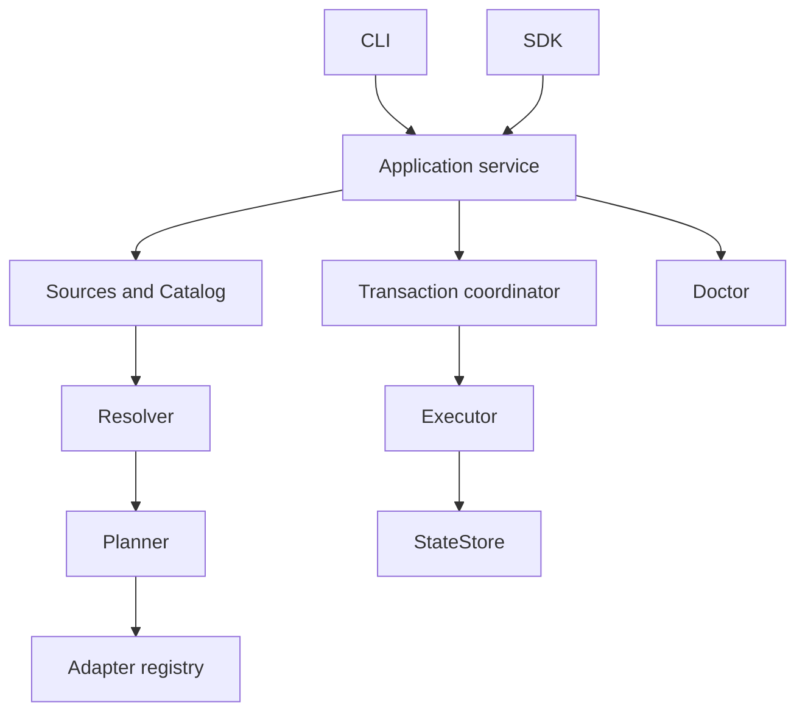

# Architecture

[简体中文](architecture.zh-CN.md)

This describes the 1.0.0 implementation. The package exports `harnessbrew` and the adapter type contract `harnessbrew/adapter`. CLI and SDK share the application service; the legacy `src/core` backend has been removed.

## Responsibilities

| Layer | Responsibility | Boundary |
| --- | --- | --- |
| `domain` | Identities, versioned formats, ownership, graph and plan contracts | No orchestration or target writes |
| `sources` / `catalog` | Verify Git snapshots and content inventories; parse available assets | Updating a source does not upgrade installed assets |
| `resolution` | Resolve dependency closure and conflicts for all root requirements | Produces decisions without filesystem mutations |
| `planning` | Compare desired and committed state; produce operations and preconditions | Plans are data, not executable callbacks |
| `adapters` | Translate asset kinds and placements into target resources | No transaction or Home ownership |
| `storage` | Read and publish immutable state revisions | No dependency or placement decisions |
| `transactions` | Coordinate locks, durable journal, commit and recovery | Owns the mutation lifecycle |
| `execution` | Validate and apply content, file and state changes | Executes authorized plans under the coordinator |
| `diagnostics` | Inspect content, target, dependency, ownership and state consistency | Findings alone do not authorize repair |
| `application` | Compose use cases, previews, queries, authorization and recovery | Shared entry for CLI and SDK |
| `cli` | Parse arguments, call service and render results | No separate business implementation |

## State and ownership

A Home stores `CURRENT`, immutable `revisions/*.json`, content addressed directories under `content/`, and a pending `transaction.json` journal. Source, plugin and preview caches live beside the Home and are disposable. Installed content and committed ownership remain authoritative when a source cache disappears.

Each manual root and each Bundle binding owns its requirements, dependency closure and placements. A coordinate has one active version per Home; incompatible owner requirements fail resolution. Removing one owner preserves resources still required by another. A Bundle binding combines its declared ID with its canonical manifest directory, so separate checkouts remain independent. Its portable lock records exact versions and manifest/adapter signatures.

## Planning and transactions

`createHarness` exposes `plan`, `execute`, `apply`, `query`, `doctor`, `recover` and `close`. A preview is saved locally with an ID and digest. Applying it checks revision, physical Home identity, sources, plugins, manifest/lock and target fingerprints. Arbitrary caller-supplied operation JSON is not an execution API.

The coordinator acquires the Home lock, the same-user external lock and sorted target locks. One session reuses these locks across nested work. Reads wait for the Home lock; pending recovery blocks ordinary queries and previews. Source/plugin metadata publication also uses the journal.

A durable committed journal marks the commit point. Earlier failures roll back using recorded before/after evidence. Recovery refuses to overwrite unexplained external changes. Cleanup first publishes removal of orphan state, then quarantines and deletes content whose inode and inventory still match. Partial deletion can resume; unexpected modifications retain recovery evidence.

## Targets and plugins

The built-in Codex adapter maps skills to directory links, agents to managed TOML files, workflows/prompts to generated skills, instructions to owned blocks, and MCP configuration to structured keys. Shared files preserve unrelated content.

Each service has its own adapter registry. Third-party adapters require explicit capabilities and currently support file/directory links. Plugin inventory signatures include dependencies and lockfiles. Verified copies are published into a signature cache before import. This checks identity and drift; JavaScript plugins still run with the process's privileges.

Doctor reports grouped findings. Repair recreates missing resources by default. Explicit overwrite is limited to identifiable owned keys or blocks; a modified whole file or link is not overwritten solely because its path was once managed.

## Compatibility and validation

Version 1 formats require explicit format/version declarations. Old Homes, Formulae, manifests, plugins and CLI aliases are rejected without automatic conversion. See the [README](../README.md) for current contracts and [1.0.0 release notes](releases/release-1.0.0.md) for adoption steps.

Fast tests cover domain through application behavior, including real process locks and crash recovery. Packaged tests exercise the installed candidate. Linux/macOS gates and real Codex preflight must reference the same candidate hash. Mock runtime tests verify the preflight harness, not Codex compatibility. See [phase 7 evidence](design/phase7-implementation.zh-CN.md) for the checks actually run.
