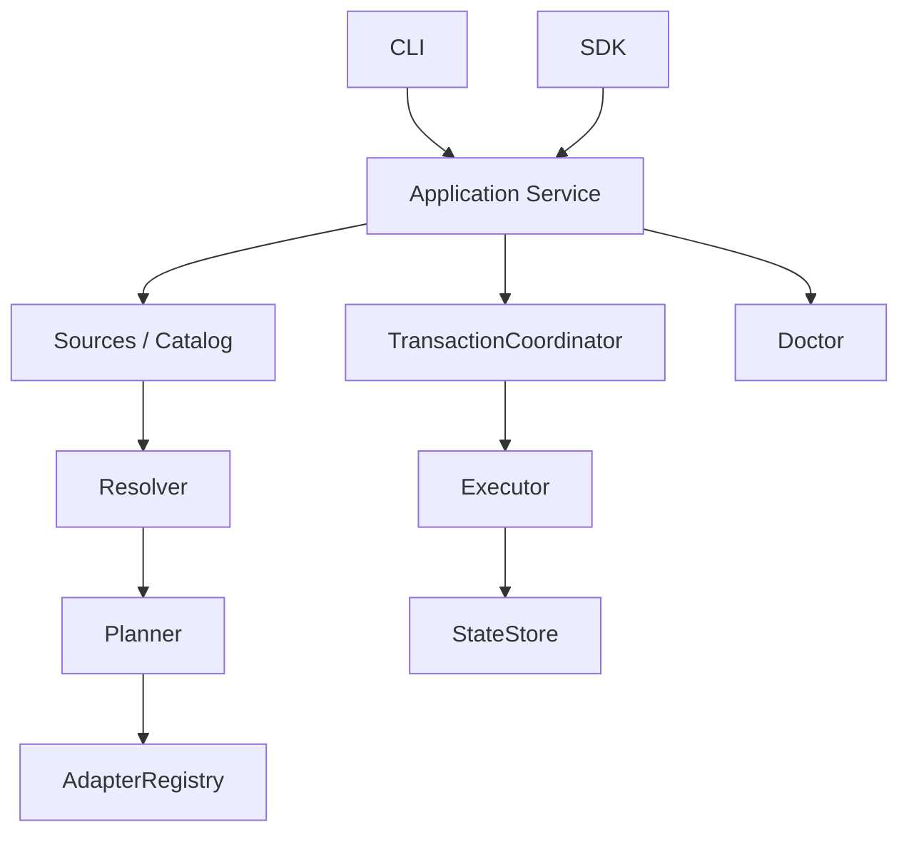

# 项目架构

[English](architecture.md)

本文描述 1.0.0 的实现。公开入口为 `harnessbrew` 与适配器类型契约 `harnessbrew/adapter`。CLI 和 SDK 共用 Application Service，旧 `src/core` 后端已删除。

## 职责边界

| 层 | 主要责任 | 边界 |
| --- | --- | --- |
| `domain` | 标识、版本化格式、所有权、依赖图与计划契约 | 不编排业务，不写目标文件 |
| `sources` / `catalog` | 校验 Git 快照和内容清单，解析可用资产 | 更新来源不等于升级安装 |
| `resolution` | 汇总所有根需求，求解依赖闭包与冲突 | 不修改文件系统 |
| `planning` | 比较期望状态与已提交状态，生成操作和前置条件 | 计划只包含数据 |
| `adapters` | 将资产类型和投放位置转换为目标资源 | 不管理 Home 或事务 |
| `storage` | 读取和发布不可变状态修订 | 不决定依赖与投放策略 |
| `transactions` | 锁、持久化日志、提交与恢复 | 统一管理变更生命周期 |
| `execution` | 校验并执行内容、文件和状态变更 | 在协调器保护下执行已授权计划 |
| `diagnostics` | 检查内容、目标、依赖、所有权和状态 | 诊断结果不自动授权修复 |
| `application` | 组合用例、预览、查询、授权和恢复 | CLI/SDK 共用业务入口 |
| `cli` | 参数解析、服务调用、结果展示 | 不另建业务实现 |

## 状态与所有权

Home 保存 `CURRENT`、不可变的 `revisions/*.json`、按内容摘要寻址的 `content/` 和待恢复的 `transaction.json`。来源、插件和预览缓存位于 Home 旁，可重新生成。来源缓存丢失不改变已提交的安装内容与所有权。

每个手动根需求和 Bundle binding 分别拥有需求、依赖闭包及投放位置。同一 Home 中每个坐标只有一个活动版本；不同所有者的版本要求冲突时拒绝变更。移除一个所有者会保留其他所有者仍需要的资源。Bundle ID 与规范化后的 Manifest 所在目录共同确定 binding，因此不同 checkout 彼此独立。可移植 lock 记录精确版本及 Manifest、Adapter 签名。

## 计划与事务

`createHarness` 提供 `plan`、`execute`、`apply`、`query`、`doctor`、`recover`、`close`。预览保存在当前主机，以 ID 和摘要标识。执行预览时重新检查状态修订、Home 物理路径、来源、插件、Manifest/lock 和目标指纹。服务不接受任意操作 JSON 直接执行。

协调器依次持有 Home 锁、同用户外部资源锁和排序后的目标锁；同一 session 复用锁。读取等待 Home 锁；存在待恢复日志时阻止普通查询及预览。来源与插件元数据变更也通过日志发布。

持久化的 committed 日志是提交点。提交前失败根据记录的变更前后证据回滚；恢复遇到无法解释的外部修改时拒绝覆盖。Cleanup 先提交孤儿状态移除，再校验 inode 和清单、隔离并删除内容。部分删除可以恢复；发现未知修改时保留隔离目录与日志。

## 目标与插件

内置 Codex Adapter 将 skill 映射为目录链接、agent 映射为托管 TOML 文件、workflow/prompt 映射为生成的 skill、instruction 映射为拥有标记的区块、MCP 映射为结构化配置键。修改共享文件时保留无关内容。

每个服务实例拥有独立 AdapterRegistry。第三方 Adapter 必须显式授权能力，目前只支持文件和目录链接。插件签名覆盖依赖及 lockfile；校验后的副本先发布到签名缓存，再加载执行。这用于身份与漂移检查，JavaScript 插件仍具有进程权限。

Doctor 按类别输出问题。Repair 默认只恢复缺失资源；显式覆盖仅限可识别的所有权键或区块。整个文件或链接被修改后，不能仅凭历史路径认定可以覆盖。

## 兼容性与验证

新格式必须声明 format/version。旧 Home、Formula、Manifest、插件与旧命令别名不自动转换。当前用法见 [README](../README.zh-CN.md)，重新接入步骤见 [1.0.0 发布说明](releases/release-1.0.0.md)。

快速测试覆盖领域到业务入口，并包含真实进程锁和崩溃恢复；打包测试验证实际安装后的候选包。Linux/macOS gate 与真实 Codex preflight 必须引用同一个候选包摘要。模拟 runtime 测试仅证明验收工具自身行为，不能替代真实 Codex 验证。实际执行结果见[阶段 7 记录](design/phase7-implementation.zh-CN.md)。

内容库存以摘要登记清单和精确来源，与当前安装坐标分离；升级旧版本保留库存，cleanup 按活动引用回收。repair 在写事务外准备精确 commit 内容，事务内校验并隔离/恢复；修改内容的隔离路径保存在 quarantines。详见 [内容生命周期](design/content-lifecycle.zh-CN.md)。
